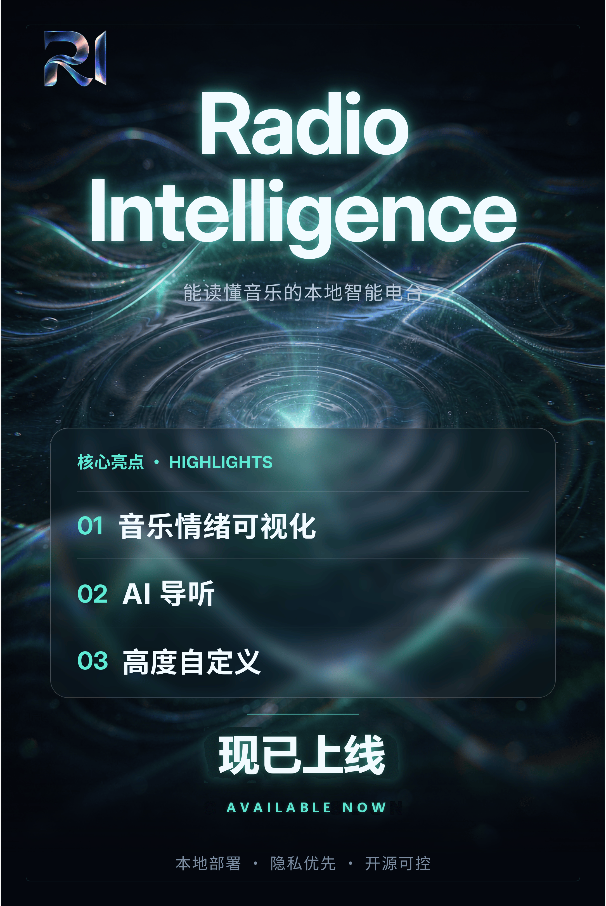
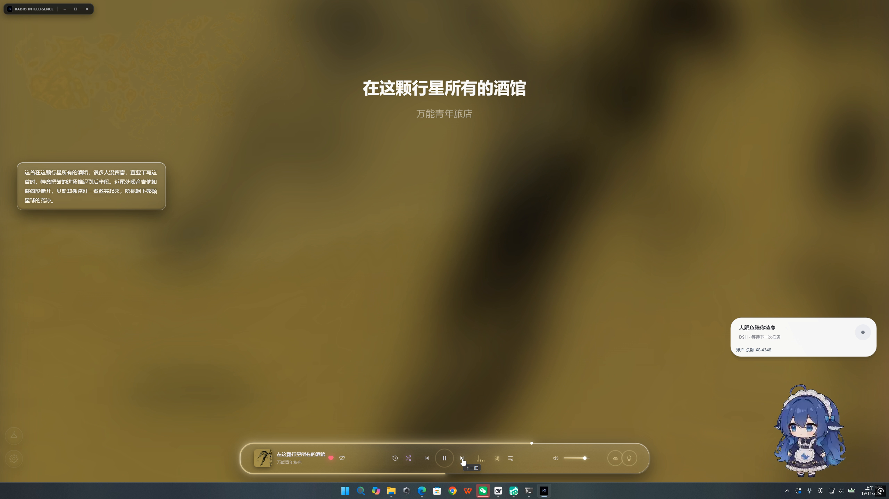
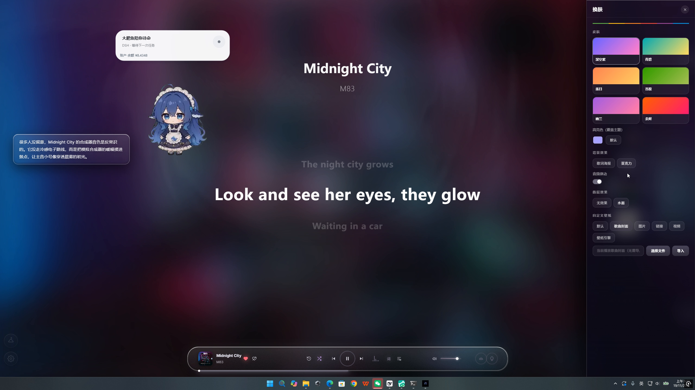
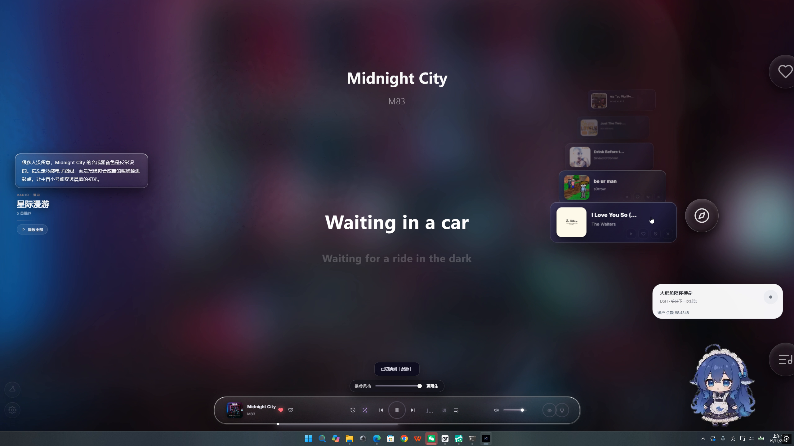
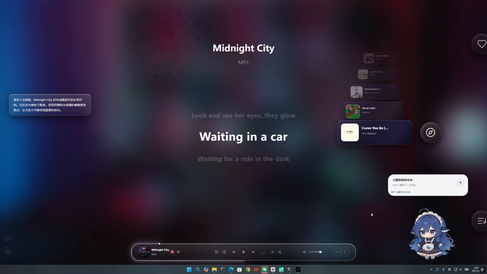
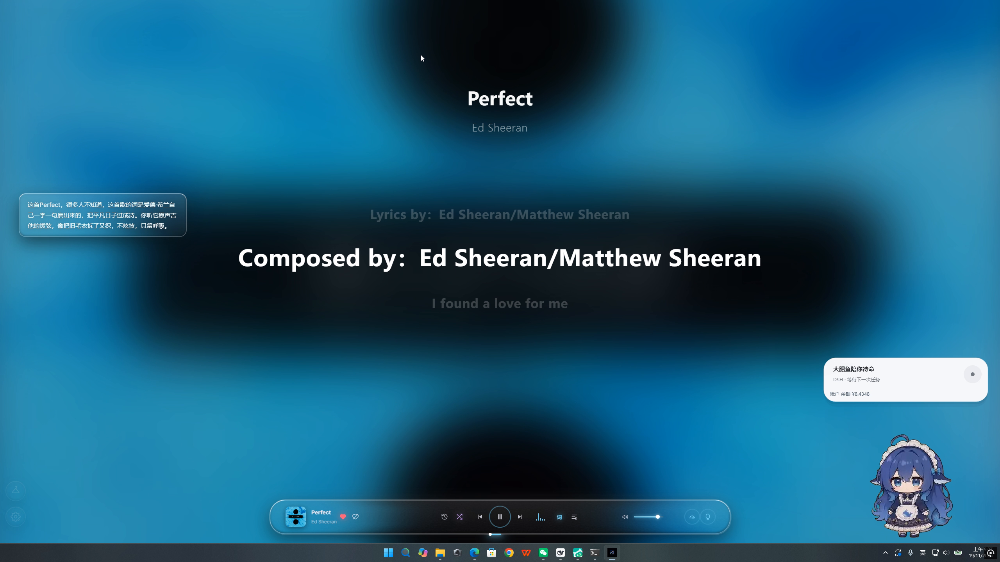
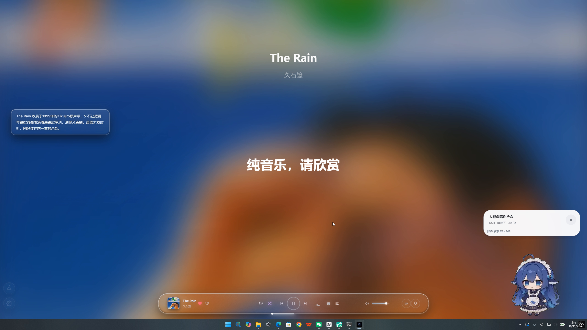

# Radio Intelligence · MusicAI

**A local-first AI radio that reads how the music feels.**

[中文](README_zh.md) · **English**

> **Source is visible here; rights are reserved.** The source tree is made visible for reading and study. All artistic content, code skeleton and algorithms remain **All Rights Reserved** — only the author may distribute or authorise commercial use. See [Repository scope](#repository-scope) and [License](LICENSE.md).

---

## Demo

Real-time screen recordings, 2560×1440 @ 60 fps. Click through to stream in GitHub's built-in player.

| Video | Length | Size | Content |
|---|---|---|---|
| [▶ Full demo](https://github.com/Julian-Donald-Von/Radio-Intelligence/releases/download/v1.0.0/full-demo-clean.mp4) | 4:52 | 37 MB | Full run, overlay trimmed: mood visuals, AI DJ, synced lyrics, track switching, pure-music mode |
| [▶ Highlights](https://github.com/Julian-Donald-Von/Radio-Intelligence/releases/download/v1.0.0/highlights.mp4) | 0:52 | 12 MB | Four-song montage |
| [▶ Short demo](https://github.com/Julian-Donald-Von/Radio-Intelligence/releases/download/v1.0.0/short-demo.mp4) | 1:21 | 20 MB | Trimmed clip |

> Videos are **visually lossless re-encodes** (H.265/x265) — near-identical picture, original 60 fps / 2560×1440 and audio preserved.

### Screenshots

| | |
|---|---|
|  AI DJ intro |  Mood visuals & palette |
|  Lyrics & queue |  Track switching |
|  Composer card |  Pure-music mode |

---

## Highlights

### 1. Music Emotion Visualization
Music rises and falls on liquid glass; color flows with the mood. A WebGL2 water body, global refraction and a lens-like glass layer react to the audio spectrum and beat in real time.

### 2. AI DJ Commentary
An LLM DJ whispers track intros, weather and location, composer notes and recommendation reasons. Music ducks to ~15% during speech and swells back afterwards.

### 3. Deep Customization
Sources, AI, voice and appearance are all yours to tune — pluggable sources, an OpenAI-compatible endpoint, selectable TTS voices and a palette panel.

**Design philosophy — Liquid Silence**: one surface, a still body of water disturbed by sound; ripples, wavefronts and refracted light grow out of the water; a breathing core sits at the center. The interface is itself a mood-driven liquid-glass instrument.

---

## Overview

Radio Intelligence (MusicAI) is a local-first AI radio. It turns a personal library into a continuous broadcast: it programs the music, writes and speaks its own DJ segments in multiple languages, and — quietly, in the background — reads how the music *feels*. Everything runs on one consumer machine (reference: an RTX 4060 laptop, 8 GB): an on-device LLM plays the DJ, an on-device speech stack does the talking, and music understanding works directly from audio. No cloud account, API key or subscription for the core loop.

---

## How a broadcast works

1. **Queue, not playlist.** A short look-ahead queue (current + next four) refills as tracks roll off, driven by *continuous* (stay near) or *leap* (jump style) recommendation.
2. **Narration prepared ahead.** As soon as a track enters the queue its DJ segment is generated (retrieval → LLM writing → speech synthesis); by song start the audio is already on disk, keeping transitions calm.
3. **Ducking with honest timing.** Music dips when speech starts and returns only after narration has actually finished — the fade is tied to end-of-playback.
4. **Transitions decided, not fixed.** The controller picks intro / outro / none per transition; dislikes feed back into what gets queued.
5. **State over WebSocket.** Every state change is pushed to the UI; the frontend holds no business logic.

---

## System architecture

```mermaid
flowchart LR
    subgraph FE["Frontend — no framework, no build step"]
        A["HTML/CSS + JS modules"]
        B["WebGL / WebGL2 layers"]
    end
    subgraph BE["Backend — FastAPI @ 127.0.0.1:8765"]
        C["REST + WebSocket"]
        D["Radio bridge / event bus"]
    end
    subgraph AI["On-device intelligence"]
        E["llama.cpp LLM (DJ)"]
        F["Qwen3-TTS 1.7B (local GGUF)"]
        G["CLAP embedding worker"]
        H["Retrieval fan-out"]
    end
    subgraph ST["Local storage"]
        I[("SQLite")]
        J[("FAISS index")]
    end
    FE <-- "WebSocket + REST" --> BE
    BE --> AI
    AI --> ST
```

The shell is a Qt (PySide6) host opening the web UI in a QWebEngineView at the local FastAPI server — one process, no browser install. The controller is composed of three mixins sharing one state object (playback orchestration, scheduling, transitions).

---

## Technical features

### Runtime & deployment
- One process, local endpoint: FastAPI + Uvicorn @ `127.0.0.1:8765`, REST for commands, WebSocket for state.
- Local LLM by default (llama.cpp with Qwen3.6-35B-A3B GGUF). A global lock serializes generation; prompts are structured for KV-cache hits.
- Measured: one narration ≈ 5 s end-to-end after tuning (from ≈ 23 s) — the win came from batching prefill.
- VRAM is budgeted: on 8 GB the LLM stays resident while TTS and the embedding worker take fixed fractions; no CUDA → CPU fallback.

### Speech
- One local TTS engine: Qwen3-TTS 1.7B (llama.cpp GGUF), covering ZH/EN/JA.
- Speech runs locally; synthesis is not the reason a transition feels late.
- Single engine, no fallback chain — when TTS is unavailable, narration stays silent rather than blocking playback.

### Music understanding & retrieval
- 512-d LAION-CLAP embeddings from audio in an **isolated worker process**; half-precision vectors in SQLite, indexed with FAISS `IndexFlatIP` (cosine on normalized vectors).
- Retrieval fans out concurrently across 360 Search, Sogou and Bing RSS, merged with per-engine weights and a relevance gate; MusicBrainz and a local `sqlite-vec` corpus supplement it, with a 30-day cache.
- Two recommendation modes over the same index: *continuous* (similarity) and *leap* (deliberate style jump).

### Frontend
- No framework, no build step: hand-written HTML/CSS/JS in ~10 modules.
- Two rendering mechanisms: a WebGL shader for the full-screen ambient field, and per-element glass via SDF displacement maps driven through `backdrop-filter`, plain blur as fallback.
- LRC lyrics with per-line highlight and next-line preview; instrumentals are announced, not forced into empty lyrics.

### Verification
- Development used extensive end-to-end verification scripts as per-round acceptance gates; these are not distributed with this repository.

---

## Emotion recognition

The system reads the emotional character of each track from its audio — **on-device, offline**.

- **It follows the song, not the file** — a track that turns halfway through is read as turning, not averaged into one mood.
- **It survives a style change** — Chinese pop, Japanese rock, English hip-hop and instrumental score share one read-out; instrumentals handled explicitly.
- **It stays stable across a switch** — the reading settles into the new song instead of snapping.
- **It answers inside the broadcast window** — per-segment inference adds milliseconds; visible latency is dominated by synthesis and the local LLM.
- **It fits next to everything else** — the whole path runs in the memory left beside a resident LLM on an 8 GB card.

The research targets **recognition quality under a deployability budget** — SOTA among models that can actually ship on an 8 GB consumer GPU beside a live LLM. This repository does not include evaluation numbers; the model, training protocol, label sources and scores are outside its scope.

---

## Research: an evaluation-protocol problem worth fixing

When you compare two frozen representations, how much of the "winner" is the representation and how much is the protocol you measured it with?

- **A single number hides a curve** — reporting the gap at one regularization setting reports one point of a path; move off it and the headline effect shrinks.
- **"Best for each arm" and "the same for both arms" are different questions** — letting each pick its own near-optimal coefficient is not a more generous shared-coefficient comparison; the sign is not even determined.
- **The solver is part of the experiment** — changing only the numerical solver moved the set of admissible configurations from less than half the grid to all of it.
- **None of this is specific to music** — the same structure appears in NLP/vision spot-checks.

**The takeaway we apply to ourselves:** never select a representation, or claim one is better, on a single coefficient and a single solver. Report the landscape.

This is an engineering observation about evaluation practice; it does not depend on any particular model or dataset.

---

## Stack

| Layer | Choice |
|---|---|
| App shell | PySide6 (Qt) + QWebEngineView |
| Backend | FastAPI + Uvicorn, REST + WebSocket, `127.0.0.1:8765` |
| Frontend | Hand-written HTML/CSS/JS, no framework or build; WebGL/WebGL2 |
| LLM | Local llama.cpp (Qwen3.6-35B-A3B GGUF) |
| Speech | Qwen3-TTS 1.7B (local llama.cpp GGUF, ZH/EN/JA) |
| Representation | LAION-CLAP, 512-d, 10 s window / 5 s hop |
| Vector search | FAISS `IndexFlatIP` (cosine), numpy fallback |
| Storage | SQLite — tracks, segments, embeddings, playlists, history, preferences |
| Retrieval | 360 / Sogou / Bing RSS (weighted merge) + MusicBrainz + local `sqlite-vec` |
| Audio engine | pygame mixer, two-channel ducking |
| Python | 3.13 (bundled by installer) |
| GPU | Designed for RTX 4060 Laptop 8 GB; CPU-only without CUDA |

---

## Repository scope

- **In this repository:** this README, screenshots, three recordings and the poster.
- **Visible but rights-reserved:** the source tree (readable, not licensed for redistribution or commercial use); the visual layer's rendering model and parameterization; the emotion-recognition model and training protocol. **Not included here:** internal research details.
- Recordings show the application as it actually ran on the developer's machine.

---

## License

### Documentation
The written documentation is licensed under [CC BY-NC-ND 4.0](https://creativecommons.org/licenses/by-nc-nd/4.0/): share and view with attribution for **non-commercial** purposes; **no** distribution of modified versions.

### Artistic, creative, code-skeleton & algorithmic content

<b>© 2026 Mr. Unpunctual. All rights reserved.</b>

This notice covers all rights the author holds under applicable law in the **visual and artistic features, creative assets, code skeleton (templates / scaffolding) and algorithms** of this project — including the liquid water body, global refraction, liquid-glass lens, poster canvas, breathing core, ripple / wavefront rendering, palettes, the RI logo, the poster, cover artwork, screenshots, generated visual assets, and any artistic or design features. This is a worldwide **all-rights-reserved** declaration, **not limited to this repository**; it applies wherever these works appear.

- Public display, access or the technical ability to download does **not** constitute an open licence or permission for commercial use.
- No commercial use — including paid distribution, publication, advertising, merchandise or commercial adaptation — is permitted without the author's prior **written** permission.
- Republication, copying, redistribution, further translation, adaptation and derivative works likewise require written permission; attribution or a stated noncommercial purpose alone grants nothing.
- A licence for the documentation or website code does **not** automatically cover this creative content. Statutory exceptions (fair use / fair dealing) and hosting-platform rights remain unaffected.
- No rights are assigned or transferred by this notice. For any permission, obtain written consent from the author.

### Third-party music sources / 第三方音源
**EN** — This distribution contains **no third-party music-source integration** from commercial music platforms. Such services are **not** bundled. If the user chooses to add them as plugins, the user alone is responsible for any terms of service, copyright and local legal compliance; the author grants no rights to those services and assumes no liability for their use.
**中文** — 本发行版**不含任何第三方音乐平台接入**，这些服务**不随包分发**。若用户自行以插件形式添加，其服务条款、版权及当地法律合规均由用户自行负责；作者不授予任何相关权利，亦不承担由此产生的责任。

---

## Buy me a drink

If Radio Intelligence made your listening a little better, you can buy me a drink. Thank you. ☕

**WeChat Pay / 微信支付** — scan the QR below (recommended):

  

**FPS / 转数快** — scan to pay:

  

| Method | Details |
|---|---|
| WeChat Pay | QR above · 微信扫码 |
| FPS (Faster Payment System) | ID `130236169` |
| Bank transfer | The Hongkong and Shanghai Banking Corporation Limited (HSBC) · Account `090 571969 833` |

---

<i>Built with care.</i>

