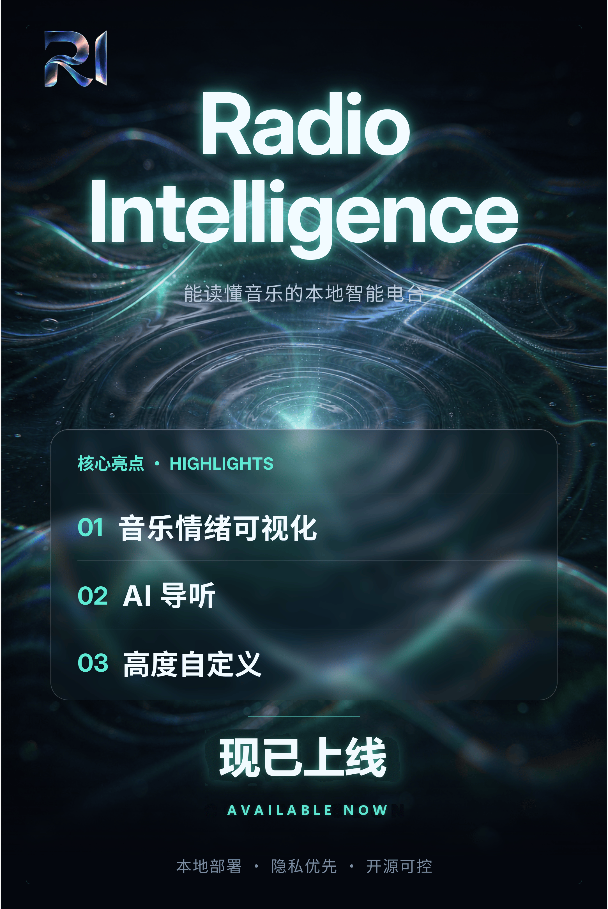
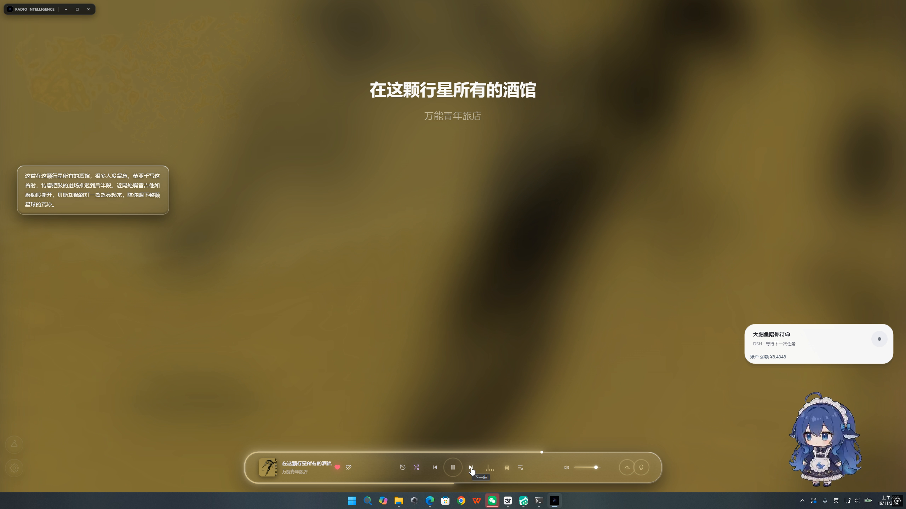
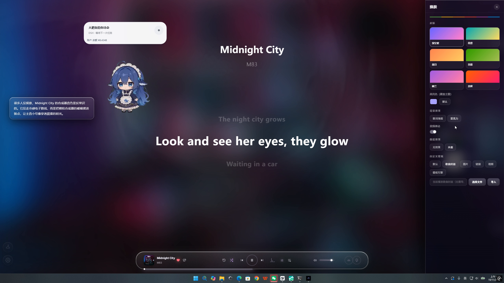
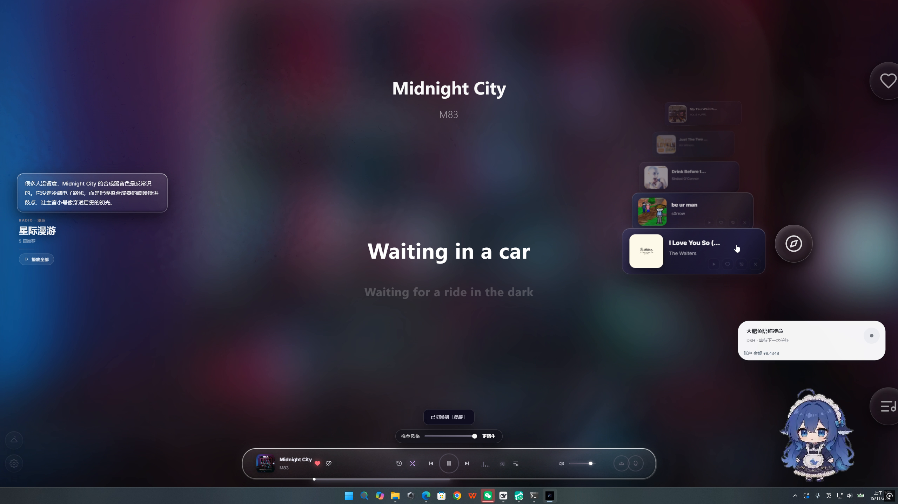
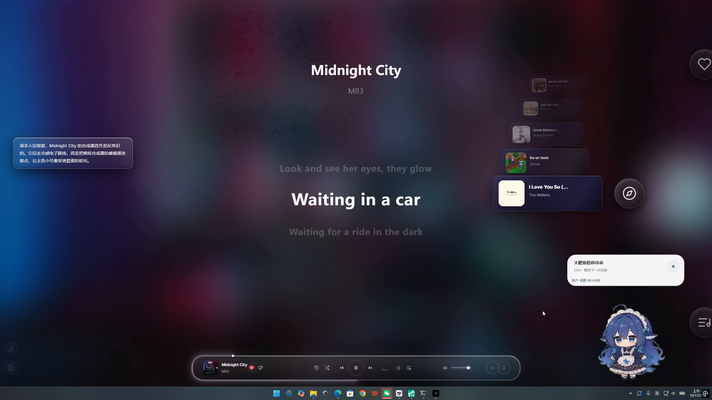
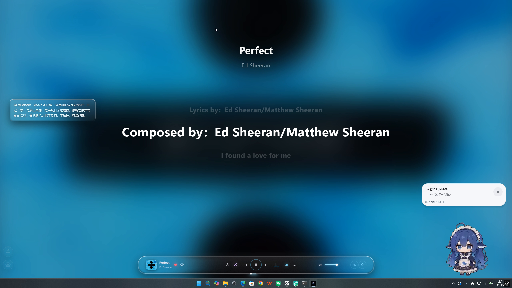
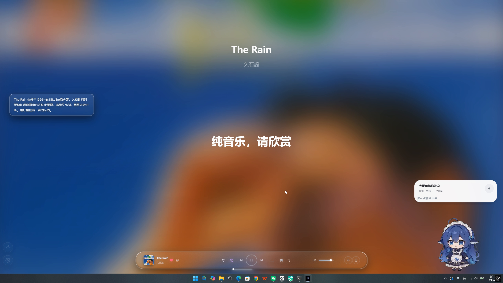

# Radio Intelligence · MusicAI

**会读懂心情的本地智能电台 / A local-first AI radio that reads how the music feels.**

> **源码可见，权利保留。** 本仓库公开源码供阅读与研究；美术、代码骨架与算法一律 **All Rights Reserved**，仅作者可分发或授权商业使用。详见 [仓库范围](#仓库范围--repository-scope) 与 [授权声明](LICENSE.md)。
> **Source is visible here; rights are reserved.** The source tree is made visible for reading and study. All artistic content, code skeleton and algorithms remain **All Rights Reserved** — only the author may distribute or authorise commercial use. See [Repository scope](#仓库范围--repository-scope) and [License](LICENSE.md).

---

## 演示 / Demo

真实运行录屏，2560×1440 @ 60 fps。点开文件页即可用 GitHub 内置播放器观看。
Real-time screen recordings, 2560×1440 @ 60 fps — click through to stream in GitHub's built-in player.

| 视频 / Video | 时长 / Length | 大小 / Size | 内容 / Content |
|---|---|---|---|
| [▶ 完整版 Full demo](https://github.com/Julian-Donald-Von/Radio-Intelligence/releases/download/v1.0.0/full-demo-clean.mp4) | 4:52 | 37 MB | 全程演示，已去除录屏标志：情绪可视化、AI 导听、逐句歌词、切歌、纯音乐模式 / Full run, overlay trimmed: mood visuals, AI DJ, synced lyrics, track switching, pure-music mode |
| [▶ 精华版 Highlights](https://github.com/Julian-Donald-Von/Radio-Intelligence/releases/download/v1.0.0/highlights.mp4) | 0:52 | 12 MB | 四段精华拼接 / Four-song montage |
| [▶ 短版 Short demo](https://github.com/Julian-Donald-Von/Radio-Intelligence/releases/download/v1.0.0/short-demo.mp4) | 1:21 | 20 MB | 掐头去尾版 / Trimmed clip |

> 视频为**视觉无损重编码**（H.265/x265），画质与原始 60 fps / 2560×1440 几乎无差，音轨保留。
> Videos are **visually lossless re-encodes** (H.265/x265) — near-identical picture, original 60 fps / 2560×1440 and audio preserved.

### 截图 / Screenshots

| | |
|---|---|
|  AI 导听开场 / AI DJ intro |  情绪可视化与调色 / Mood visuals & palette |
|  逐句歌词与队列 / Lyrics & queue |  切歌 / Track switching |
|  作曲信息卡 / Composer card |  纯音乐模式 / Pure-music mode |

---

## 三大亮点 / Highlights

### 1. 音乐情绪可视化 / Music Emotion Visualization
音乐在液态玻璃上起伏，颜色随心情流动。WebGL2 水体、全局折射与透镜式液态玻璃层实时响应音频频谱与节拍。
Music rises and falls on liquid glass; color flows with the mood. A WebGL2 water body, global refraction and a lens-like glass layer react to the audio spectrum and beat in real time.

### 2. AI 导听 / AI DJ Commentary
大模型 DJ 在耳边低语——歌曲介绍、天气地点、作曲信息、推荐理由。口播时音乐压低至约 15%，结束后渐强恢复。
An LLM DJ whispers track intros, weather and location, composer notes and recommendation reasons. Music ducks to ~15% during speech and swells back afterwards.

### 3. 高度自定义 / Deep Customization
音源、AI、口播、外观全部可调。可插拔音源、OpenAI 兼容端点、可选 TTS 音色与可视化配色面板。
Sources, AI, voice and appearance are all yours to tune — pluggable sources, an OpenAI-compatible endpoint, selectable TTS voices and a palette panel.

**设计哲学 · 液态静默 / Design philosophy — Liquid Silence**：一张被声音扰动的水面，涟漪、波前与折射光都从水中生长，中央是一枚呼吸的核。界面本身就是一件随心情起伏的液态玻璃乐器。
*One surface: a still body of water disturbed by sound; ripples, wavefronts and refracted light grow out of the water; a breathing core sits at the center. The interface is itself a mood-driven liquid-glass instrument.*

---

## 简介 / Overview

**中文** — Radio Intelligence（MusicAI）是一个本地运行的 AI 智能电台：它把个人曲库变成连续广播——自动编排音乐、用多种语言撰写并播报自己的 DJ 段落，并在后台读取音乐的情绪。核心闭环全部在一台消费级机器上完成（参考部署：RTX 4060 笔记本，8 GB）——本地 LLM 担任 DJ，本地语音栈负责发声，音乐理解直接从音频工作。无需云账号、API key 或订阅。

**EN** — Radio Intelligence (MusicAI) is a local-first AI radio. It turns a personal library into a continuous broadcast: it programs the music, writes and speaks its own DJ segments in multiple languages, and — quietly, in the background — reads how the music *feels*. Everything runs on one consumer machine (reference: an RTX 4060 laptop, 8 GB): an on-device LLM plays the DJ, an on-device speech stack does the talking, and music understanding works directly from audio. No cloud account, API key or subscription for the core loop.

---

## 一次广播如何运作 / How a broadcast works

1. **队列而非歌单 / Queue, not playlist.** 控制器维持一个短前瞻队列（当前+后四首），随播放滚动补充；填充由推荐引擎驱动，分 `continuous`（贴近当前声音）与 `leap`（刻意跳跃风格）两档。/ A short look-ahead queue (current + next four) refills as tracks roll off, driven by *continuous* (stay near) or *leap* (jump style) recommendation.
2. **旁白提前备好 / Narration prepared ahead.** 歌曲一入队即生成 DJ 段落（检索→LLM 写作→语音合成）；歌开始时音频已落盘，转场因此从容。/ As soon as a track enters the queue its DJ segment is generated; by song start the audio is already on disk, keeping transitions calm.
3. **诚实的闪避 / Ducking with honest timing.** 音乐在人声开始时压低，仅在旁白**真正播完后**恢复——淡入绑定播放结束事件。/ Music dips when speech starts and returns only after narration has actually finished — the fade is tied to end-of-playback.
4. **转场是决策不是固定 / Transitions decided, not fixed.** 控制器每次选择 intro / outro / none；dislike 反馈进下一轮排队。/ The controller picks intro/outro/none per transition; dislikes feed back into what gets queued.
5. **状态走 WebSocket / State over WebSocket.** 每次状态变化由服务端推送到 UI；前端不含业务逻辑。/ Every state change is pushed to the UI; the frontend holds no business logic.

---

## 系统架构 / System architecture

```mermaid
flowchart LR
    subgraph FE["Frontend — no framework, no build step"]
        A["HTML/CSS + JS modules"]
        B["WebGL / WebGL2 layers"]
    end
    subgraph BE["Backend — FastAPI @ 127.0.0.1:8765"]
        C["REST + WebSocket"]
        D["Radio bridge / event bus"]
    end
    subgraph AI["On-device intelligence"]
        E["llama.cpp LLM (DJ)"]
        F["Qwen3-TTS 1.7B (local GGUF)"]
        G["CLAP embedding worker"]
        H["Retrieval fan-out"]
    end
    subgraph ST["Local storage"]
        I[("SQLite")]
        J[("FAISS index")]
    end
    FE <-- "WebSocket + REST" --> BE
    BE --> AI
    AI --> ST
```

外壳是 Qt (PySide6) 宿主，用 QWebEngineView 指向本地 FastAPI 服务打开 Web UI——单进程，无需安装浏览器。控制器由三个共享同一状态对象的 mixin 组成（播放编排、调度、转场）。
The shell is a Qt (PySide6) host opening the web UI in a QWebEngineView at the local FastAPI server — one process, no browser install. The controller is composed of three mixins sharing one state object (playback orchestration, scheduling, transitions).

---

## 技术特性 / Technical features

### 运行与部署 / Runtime & deployment
- 单进程本地端点：FastAPI + Uvicorn @ `127.0.0.1:8765`，REST 下命令、WebSocket 推状态。/ One process, local endpoint: REST for commands, WebSocket for state.
- 默认本地 LLM：llama.cpp 承载 Qwen3.6-35B-A3B GGUF。全局锁串行化生成，提示词结构化以命中 KV cache。/ Local LLM by default (llama.cpp with Qwen3.6-35B-A3B GGUF).
- 实测：调优后单段旁白端到端 ≈ 5 s（原 ≈ 23 s），收益来自 batching prefill。/ Measured: one narration ≈ 5 s end-to-end (from ≈ 23 s), the win came from batching prefill.
- 显存是预算出来的：8 GB 卡上 LLM 常驻，TTS 与 embedding worker 占固定份额；无 CUDA 则全部回落 CPU。/ VRAM is budgeted: on 8 GB the LLM stays resident while TTS and the embedding worker take fixed fractions; no CUDA → CPU fallback.

### 语音 / Speech
- 单一本地语音引擎：Qwen3-TTS 1.7B（llama.cpp GGUF），覆盖中/英/日。/ One local TTS engine: Qwen3-TTS 1.7B (llama.cpp GGUF), ZH/EN/JA.
- 语音在本地合成，不依赖云端。/ Speech runs locally, no cloud dependency.
- 单引擎无回退链：不可用时静音，不阻塞播放。/ Single engine, no fallback — silent rather than blocking when unavailable.

### 音乐理解与检索 / Music understanding & retrieval
- 从音频而非标签取 embedding：LAION-CLAP 512 维、10 s 窗 / 5 s hop，在**独立 worker 进程**计算；向量半精度存 SQLite，FAISS `IndexFlatIP` 建索引。/ 512-d LAION-CLAP from audio in an isolated worker; half-precision vectors in SQLite, indexed with FAISS `IndexFlatIP`.
- 检索并发扇出：360 搜索、搜狗、Bing RSS 三路并发，按权重与相关度闸合并；MusicBrainz 与本地语料作补充，带 30 天缓存。/ Retrieval fans out concurrently across 360/Sogou/Bing RSS with weighted merge.

### 前端 / Frontend
- 无框架、无构建步骤：手写 HTML/CSS/JS 拆成约 10 个模块。/ No framework, no build step: hand-written HTML/CSS/JS in ~10 modules.
- 两套渲染机制：WebGL shader 做全屏环境折射场，逐元素玻璃用 `backdrop-filter` 驱动的 SDF 位移贴图，普通模糊兜底。/ A WebGL shader for the ambient field, per-element glass via SDF displacement maps through `backdrop-filter`, plain blur as fallback.
- 歌词 LRC 解析、逐行高亮、下一行预览；纯音乐被识别后播报而非强塞空歌词。/ LRC lyrics with per-line highlight and next-line preview; instrumentals are announced, not forced into empty lyrics.

### 验证 / Verification
- 开发期使用大量端到端验证脚本作为逐轮验收门，未随本仓库分发。/ Development used extensive verification scripts as acceptance gates; not distributed here.

---

## 情绪识别 / Emotion recognition

系统从所播音频读取每首歌的情绪特征——**本地、离线**，不联网、不调云。
The system reads the emotional character of each track from its audio — **on-device, offline**.

- **跟歌走，不跟文件走**：歌曲中途转折就被读成转折，而非平均成单一心情。/ It follows the song, not the file.
- **扛得住风格切换**：中文流行、日文摇滚、英文嘻哈、纯音乐配乐共用一套读数；纯音乐显式处理。/ It survives a style change; instrumentals handled explicitly.
- **切换时保持稳定**：换歌时读数平滑落到新歌，而非突变。/ It stays stable across a switch.
- **在广播窗口内出结果**：段级推理只给流水线增加毫秒级开销，可见延迟由语音合成与本地 LLM 主导。/ It answers inside the broadcast window.
- **与一切共存**：整条识别路径跑在 8 GB 上常驻 LLM 之外的剩余显存里。/ It fits in the memory left beside a resident LLM on an 8 GB card.

其研究纲领瞄准一个明确的最前沿轴心：**可部署预算下的识别质量**——在真正能跑在 8 GB 消费卡、与 live LLM 共存的模型里做到最好。具体数字不在此复现；模型、训练协议、标签来源与分数均不在本仓库范围。
The research targets **recognition quality under a deployability budget** — SOTA among models that can actually ship on an 8 GB consumer GPU beside a live LLM. Reported numbers are not reproduced here; the model, protocol, labels and scores are outside this repository's scope.

---

## 研究：一个值得修正的评估协议问题 / Research: an evaluation-protocol problem

比较两份冻结表征时，"赢家"里有多少来自表征本身、多少来自你用来测它的协议？
When you compare two frozen representations, how much of the "winner" is the representation and how much is the protocol?

- **一个数字藏住一条曲线**：只报告单个正则系数下的差距等于报告路径上的一个点；挪开该点，headline 效应显著缩水。/ A single number hides a curve.
- **"各臂最优"与"两臂同参"是两个问题**：让每个表征自选系数并不是更宽松版的共享系数比较，符号都不一定确定。/ "Best for each arm" and "the same for both arms" are different questions.
- **求解器也是实验的一部分**：仅更换数值求解器，就让可接受配置从网格的不到一半变成全部。/ The solver is part of the experiment.
- **这非音乐独有**：NLP/视觉抽检出现同样结构。/ None of this is specific to music.

**我们据此约束自己**：永远不要在单一系数、单一求解器上选表征或宣称更优；要报告全貌，至少报告范围。
**The takeaway:** never select a representation, or claim one is better, on a single coefficient and a single solver. Report the landscape.

此处仅描述问题与发现的形状，不提供标识或数字。
Only the problem and the shape of the finding are described here — no identifiers or numbers.

---

## 技术栈 / Stack

| 层 / Layer | 选择 / Choice |
|---|---|
| 外壳 / App shell | PySide6 (Qt) + QWebEngineView |
| 后端 / Backend | FastAPI + Uvicorn, REST + WebSocket, `127.0.0.1:8765` |
| 前端 / Frontend | 手写 HTML/CSS/JS，无框架无构建；WebGL/WebGL2 |
| LLM | 本地 llama.cpp（Qwen3.6-35B-A3B GGUF） |
| 语音 / Speech | Qwen3-TTS 1.7B（本地 llama.cpp GGUF，中/英/日） |
| 音乐表征 / Representation | LAION-CLAP, 512-d, 10 s 窗 / 5 s hop |
| 向量检索 / Vector search | FAISS `IndexFlatIP`（余弦），numpy 兜底 |
| 存储 / Storage | SQLite — tracks, segments, embeddings, playlists, history, preferences |
| 检索 / Retrieval | 360 / 搜狗 / Bing RSS（加权合并）+ MusicBrainz / 本地 `sqlite-vec` |
| 音频 / Audio engine | pygame mixer，双通道 ducking |
| Python | 3.13（安装器自带） |
| GPU | 面向 RTX 4060 Laptop 8 GB；无 CUDA 则纯 CPU |

---

## 仓库范围 / Repository scope

- **本仓库 / In this repo**：本 README、截图、三段录屏、海报。/ This README, screenshots, three recordings, the poster.
- **可见但权利保留 / Visible, rights-reserved**：源码树（可阅读，不授权再分发或商用）；视觉层渲染模型与参数化；情绪识别模型与训练协议。**不公开**：内部研究细节。/ Source (readable, no redistribution/commercial licence); visual model; emotion model & protocol. **Not published**: internal research details.
- 录屏展示的是应用在开发机上的实际运行。/ Recordings show the app as it actually ran on the developer's machine.

---

## 授权 / License

### 文档与说明 / Documentation
**EN** — The written documentation in this repository is licensed under [CC BY-NC-ND 4.0](https://creativecommons.org/licenses/by-nc-nd/4.0/): you may share and view it, with attribution, for **non-commercial** purposes; you may **not** distribute modified versions.
**中文** — 本仓库的文字文档采用 [CC BY-NC-ND 4.0](https://creativecommons.org/licenses/by-nc-nd/4.0/) 协议：署名前提下可出于**非商业**目的分享与浏览；**不得**分发修改版本。

### 美术、创作、代码骨架与算法 / Artistic & creative content

<b>© 2026 Mr. Unpunctual. All rights reserved. / © 2026 不准点先生。保留全部权利。</b>

This notice covers all rights the author holds under applicable law in the **visual and artistic features, creative assets, code skeleton (templates / scaffolding) and algorithms** of this project — including but not limited to the liquid water body, global refraction, liquid-glass lens, poster canvas, breathing core, ripple / wavefront rendering, palettes, the RI logo, the poster, cover artwork, screenshots, generated visual assets, and any artistic or design features. This is a worldwide **all-rights-reserved** declaration, **not limited to this repository**; it applies wherever these works appear.

本声明适用于作者在适用法律下就本项目**美术与艺术特征、创作资产、代码骨架（模板／脚手架）及算法**享有的全部权利——包括但不限于水体、全局折射、液态玻璃透镜、海报画布、呼吸核、涟漪/波前渲染、配色、RI 标志、海报、封面、截图、生成视觉资产，以及任何艺术或设计特征。这是一项全球性的 **all rights reserved（保留全部权利）** 声明，**不限于本仓库**，无论这些作品出现在何处均适用。

- Public display, access or the technical ability to download does **not** constitute an open licence or permission for commercial use. / 公开展示、能够访问或能够下载，**不构成**开放许可或商业使用授权。
- No commercial use — including paid distribution, publication, advertising, merchandise or commercial adaptation — is permitted without the author's prior **written** permission. / 未经作者事先**书面**许可，不得用于任何商业用途（付费传播、出版、广告、商品化或商业性改编）。
- Republication, copying, redistribution, further translation, adaptation and derivative works likewise require written permission; attribution or a stated noncommercial purpose alone grants nothing. / 转载、复制分发、再翻译、改编及衍生作品同样须书面许可；仅标注作者或声明非商业目的不授予任何许可。
- A licence for the documentation or website code does **not** automatically cover this creative content. Statutory exceptions (fair use / fair dealing) and rights necessarily provided by the hosting platform remain unaffected. / 文档或网页代码的任何许可都**不**自动适用于上述创作内容；法定合理使用及托管平台条款必须提供的权限不受影响。
- No rights are assigned or transferred by this notice. For any permission, obtain written consent from the author. / 本声明不转让任何权利；任何授权事宜均须取得作者书面许可。

### Third-party music sources / 第三方音源
**EN** — This distribution contains **no third-party music-source integration** from commercial music platforms. Such services are **not** bundled. If the user chooses to add them as plugins, the user alone is responsible for any terms of service, copyright and local legal compliance; the author grants no rights to those services and assumes no liability for their use.
**中文** — 本发行版**不含任何第三方音乐平台接入**，这些服务**不随包分发**。若用户自行以插件形式添加，其服务条款、版权及当地法律合规均由用户自行负责；作者不授予任何相关权利，亦不承担由此产生的责任。

---

## 请我喝一杯 / Buy me a drink

**EN** — If Radio Intelligence made your listening a little better, you can buy me a drink. Thank you. ☕
**中文** — 如果 Radio Intelligence 让你的聆听体验好了一些，欢迎请我喝一杯。谢谢。☕

  
   <i>转数快收款码 / Scan to pay via FPS</i>

| 方式 / Method | 信息 / Details |
|---|---|
| 转数快 / FPS (Faster Payment System) | ID `130236169` · 扫上方二维码 / scan the QR above |
| 银行转账 / Bank transfer | 香港上海滙豐銀行有限公司 / The Hongkong and Shanghai Banking Corporation Limited (HSBC) · 账户 / Account `090 571969 833` |

---

<i>Built with care. 用心之作。</i>

