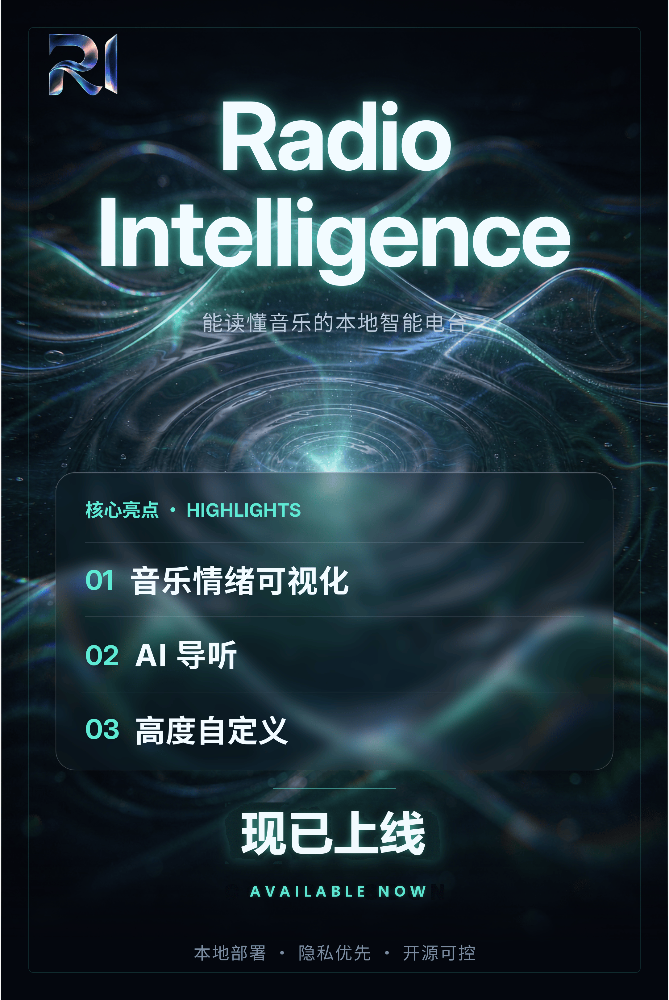
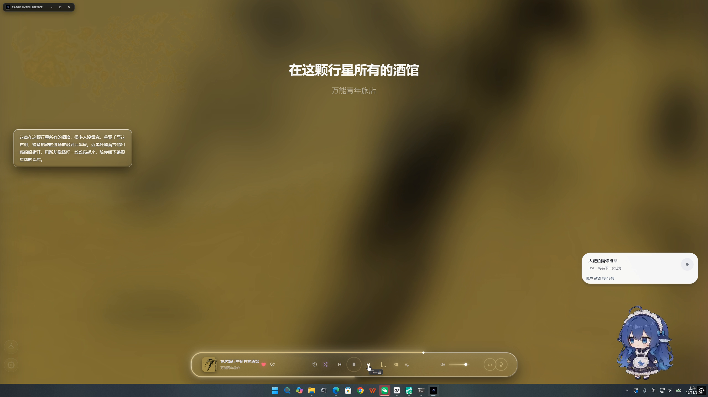
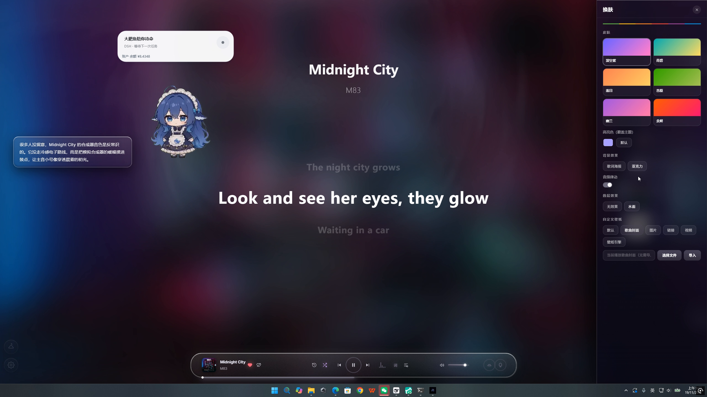
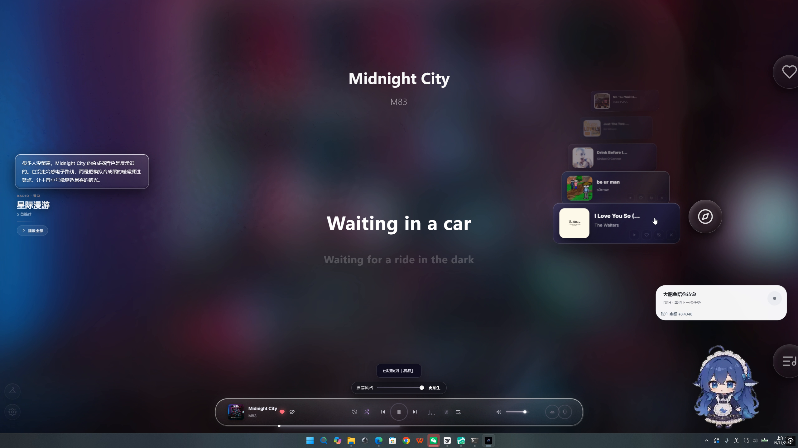
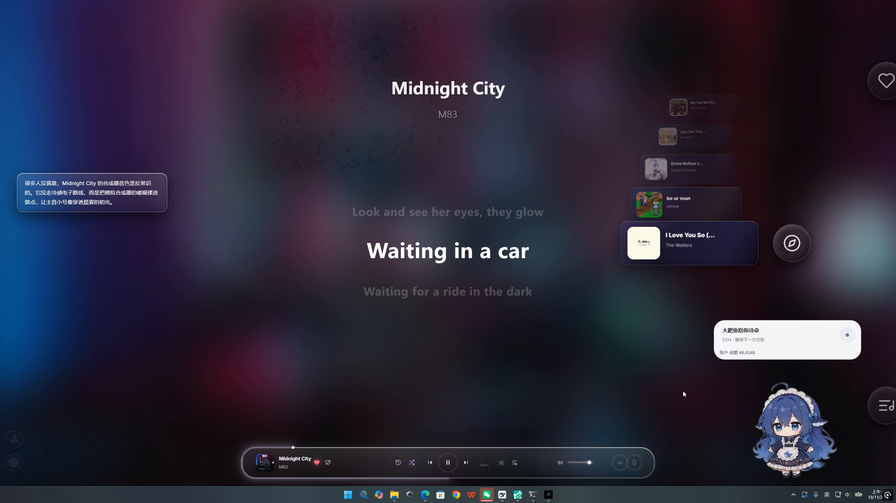
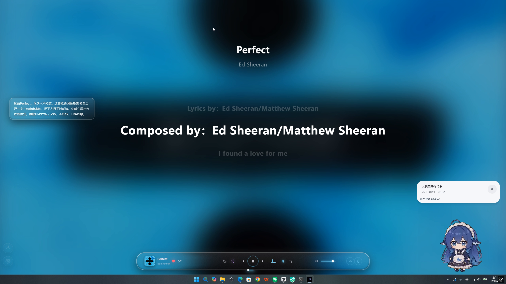
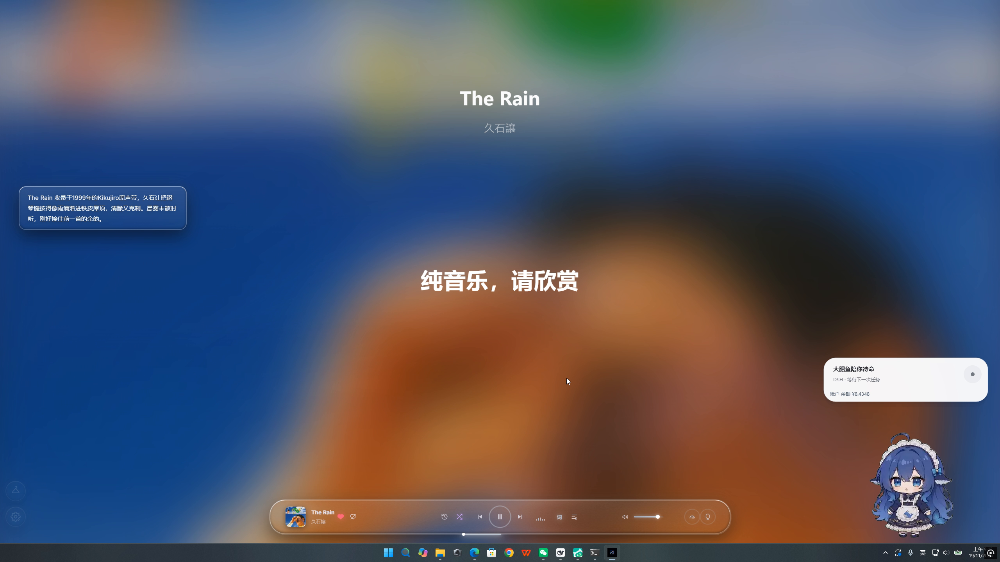
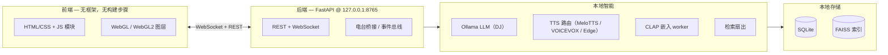

# Radio Intelligence · MusicAI

**会读懂心情的本地智能电台**

**中文** · [English](README.md)

> **源码可见，权利保留。** 本仓库公开源码供阅读与研究；美术、代码骨架与算法一律 **All Rights Reserved**，仅作者可分发或授权商业使用。详见[仓库范围](#仓库范围)与[授权声明](LICENSE.md)。

---

## 演示

真实运行录屏，2560×1440 @ 60 fps。点开文件页即可用 GitHub 内置播放器观看。

| 视频 | 时长 | 大小 | 内容 |
|---|---|---|---|
| [▶ 完整版](docs/demo/videos/full-demo-clean.mp4) | 4:52 | 37 MB | 全程演示，已去除录屏标志：情绪可视化、AI 导听、逐句歌词、切歌、纯音乐模式 |
| [▶ 精华版](docs/demo/videos/highlights.mp4) | 0:52 | 12 MB | 四段精华拼接 |
| [▶ 短版](docs/demo/videos/short-demo.mp4) | 1:21 | 20 MB | 掐头去尾版 |

> 视频为**视觉无损重编码**（H.265/x265），画质与原始 60 fps / 2560×1440 几乎无差，音轨保留。

### 截图

| | |
|---|---|
|  AI 导听开场 |  情绪可视化与调色 |
|  逐句歌词与队列 |  切歌 |
|  作曲信息卡 |  纯音乐模式 |

---

## 三大亮点

### 1. 音乐情绪可视化
音乐在液态玻璃上起伏，颜色随心情流动。WebGL2 水体、全局折射与透镜式液态玻璃层实时响应音频频谱与节拍。

### 2. AI 导听
大模型 DJ 在耳边低语——歌曲介绍、天气地点、作曲信息、推荐理由。口播时音乐压低至约 15%，结束后渐强恢复。

### 3. 高度自定义
音源、AI、口播、外观全部可调。可插拔音源、OpenAI 兼容端点、可选 TTS 音色与可视化配色面板。

**设计哲学 · 液态静默**：一张被声音扰动的水面，涟漪、波前与折射光都从水中生长，中央是一枚呼吸的核。界面本身就是一件随心情起伏的液态玻璃乐器。

---

## 简介

Radio Intelligence（MusicAI）是一个本地运行的 AI 智能电台：它把个人曲库变成连续广播——自动编排音乐、用多种语言撰写并播报自己的 DJ 段落，并在后台读取音乐的情绪。核心闭环全部在一台消费级机器上完成（参考部署：RTX 4060 笔记本，8 GB）——本地 LLM 担任 DJ，本地语音栈负责发声，音乐理解直接从音频工作。无需云账号、API key 或订阅。

---

## 一次广播如何运作

1. **队列而非歌单**：控制器维持一个短前瞻队列（当前+后四首），随播放滚动补充；填充由推荐引擎驱动，分 `continuous`（贴近当前声音）与 `leap`（刻意跳跃风格）两档。
2. **旁白提前备好**：歌曲一入队即生成 DJ 段落（检索→LLM 写作→语音合成）；歌开始时音频已落盘，转场因此从容。
3. **诚实的闪避**：音乐在人声开始时压低，仅在旁白**真正播完后**恢复——淡入绑定播放结束事件。
4. **转场是决策不是固定**：控制器每次选择 intro / outro / none；dislike 反馈进下一轮排队。
5. **状态走 WebSocket**：每次状态变化由服务端推送到 UI；前端不含业务逻辑。

---

## 系统架构

外壳是 Qt (PySide6) 宿主，用 QWebEngineView 指向本地 FastAPI 服务打开 Web UI——单进程，无需安装浏览器。控制器由三个共享同一状态对象的 mixin 组成（播放编排、调度、转场）。

---

## 技术特性

### 运行与部署
- 单进程本地端点：FastAPI + Uvicorn @ `127.0.0.1:8765`，REST 下命令、WebSocket 推状态。
- 默认本地 LLM：Ollama 承载 Qwen 系列；OpenAI 兼容端点作为可配置备选。全局锁串行化生成，提示词结构化以命中 KV cache。
- 实测：调优后单段旁白端到端 ≈ 5 秒（原 ≈ 23 秒），收益来自 batching prefill。
- 显存是预算出来的：8 GB 卡上 LLM 常驻，TTS 与 embedding worker 占固定份额；无 CUDA 则全部回落 CPU。

### 语音
- 语言标签驱动路由：LLM 输出带 `<lang>` 标签，分段器归一化后分派到 MeloTTS（本地 GPU）、VOICEVOX（日语）、Edge-TTS（云兜底）。
- 本地语音 ≈ 0.07× 实时（一分钟语音约 4 秒合成）。
- 失败优雅：引擎缺失或调用失败则顺延；全失败则以文字显示旁白，不阻塞播放。

### 音乐理解与检索
- 从音频取 512 维 LAION-CLAP 嵌入，在**独立 worker 进程**计算；半精度向量存 SQLite，FAISS `IndexFlatIP` 建索引。
- 检索扇出按成本排序：Bing RSS → DuckDuckGo → MusicBrainz → 本地 `sqlite-vec` 语料，带 30 天缓存与策划闸（测试集定义页率 28%→17%）。
- 同一索引上两种推荐模式：*continuous*（相似）与 *leap*（刻意跳跃风格）。

### 前端
- 无框架、无构建步骤：手写 HTML/CSS/JS 拆成约 10 个模块。
- 两套渲染机制：WebGL shader 做全屏环境折射场，逐元素玻璃用 `backdrop-filter` 驱动的 SDF 位移贴图，普通模糊兜底。
- 歌词 LRC 解析、逐行高亮、下一行预览；纯音乐被识别后播报而非强塞空歌词。

### 验证
- 约 170 个端到端验证脚本（`verify_*.py`）作为逐轮验收门，其中一个为全项目回归基线；它们打真实服务与真实浏览器客户端。

---

## 情绪识别

系统从所播音频读取一条情绪轨迹——不是每首一个标签，而是随音乐时间推进的动态读数；**本地、段级、离线**。

- **跟歌走，不跟文件走**：歌曲中途转折就被读成转折，而非平均成单一心情。
- **扛得住风格切换**：中文流行、日文摇滚、英文嘻哈、纯音乐配乐共用一套读数；纯音乐显式处理。
- **切换时保持稳定**：换歌时读数平滑落到新歌，而非突变。
- **在广播窗口内出结果**：段级推理只增加毫秒级开销，可见延迟由语音合成与本地 LLM 主导。
- **与一切共存**：整条识别路径跑在 8 GB 上常驻 LLM 之外的剩余显存里。

其研究纲领瞄准一个明确的最前沿轴心：**可部署预算下的识别质量**——在真正能跑在 8 GB 消费卡、与 live LLM 共存的模型里做到最好。具体数字不在此复现；模型、训练协议、标签来源与分数均不在本仓库范围。

---

## 研究：一个值得修正的评估协议问题

比较两份冻结表征时，"赢家"里有多少来自表征本身、多少来自你用来测它的协议？

- **一个数字藏住一条曲线**：只报告单个正则系数下的差距等于报告路径上的一个点；挪开该点，headline 效应显著缩水。
- **"各臂最优"与"两臂同参"是两个问题**：让每个表征自选系数并不是更宽松版的共享系数比较，符号都不一定确定。
- **求解器也是实验的一部分**：仅更换数值求解器，就让可接受配置从网格的不到一半变成全部。
- **这非音乐独有**：NLP/视觉抽检出现同样结构。

**我们据此约束自己**：永远不要在单一系数、单一求解器上选表征或宣称更优；要报告全貌，至少报告范围。

该工作已成文，**目前处于双盲评审**。为保持匿名，此处**不提供标题、链接、会议与数字**——只有问题与发现的形状。

---

## 技术栈

| 层 | 选择 |
|---|---|
| 外壳 | PySide6 (Qt) + QWebEngineView |
| 后端 | FastAPI + Uvicorn, REST + WebSocket, `127.0.0.1:8765` |
| 前端 | 手写 HTML/CSS/JS，无框架无构建；WebGL/WebGL2 |
| LLM | 本地 Ollama（Qwen 系列）；OpenAI 兼容端点备选 |
| 语音 | MeloTTS（本地 GPU）、VOICEVOX（日语）、Edge TTS（云兜底） |
| 音乐表征 | LAION-CLAP, 512 维, 10 秒窗 / 5 秒 hop |
| 向量检索 | FAISS `IndexFlatIP`（余弦），numpy 兜底 |
| 存储 | SQLite — tracks, segments, embeddings, playlists, history, preferences |
| 检索 | Bing RSS / DuckDuckGo / MusicBrainz / 本地 `sqlite-vec` |
| 音频 | pygame mixer，双通道 ducking |
| Python | 3.11+（开发测试于 3.13） |
| GPU | 面向 RTX 4060 Laptop 8 GB；无 CUDA 则纯 CPU |

---

## 仓库范围

- **本仓库**：本 README、截图、三段录屏、海报。
- **可见但权利保留**：源码树（可阅读，不授权再分发或商用）；视觉层渲染模型与参数化；情绪识别模型与训练协议。**不公开**：标签来源与分数；在审论文身份。
- 录屏展示的是应用在开发机上的实际运行。

---

## 授权

### 文档
本仓库的文字文档采用 [CC BY-NC-ND 4.0](https://creativecommons.org/licenses/by-nc-nd/4.0/) 协议：署名前提下可出于**非商业**目的分享与浏览；**不得**分发修改版本。

### 美术、创作、代码骨架与算法

<b>© 2026 不准点先生。保留全部权利。</b>

本声明适用于作者在适用法律下就本项目**美术与艺术特征、创作资产、代码骨架（模板／脚手架）及算法**享有的全部权利——包括但不限于水体、全局折射、液态玻璃透镜、海报画布、呼吸核、涟漪/波前渲染、配色、RI 标志、海报、封面、截图、生成视觉资产，以及任何艺术或设计特征。这是一项全球性的 **all rights reserved（保留全部权利）** 声明，**不限于本仓库**，无论这些作品出现在何处均适用。

- 公开展示、能够访问或能够下载，**不构成**开放许可或商业使用授权。
- 未经作者事先**书面**许可，不得用于任何商业用途（付费传播、出版、广告、商品化或商业性改编）。
- 转载、复制分发、再翻译、改编及衍生作品同样须书面许可；仅标注作者或声明非商业目的不授予任何许可。
- 文档或网页代码的任何许可都**不**自动适用于上述创作内容；法定合理使用及托管平台必须提供的权限不受影响。
- 本声明不转让任何权利；任何授权事宜均须取得作者书面许可。

### 第三方音源 / 第三方音源
本发行版**不含任何第三方音乐平台接入**，这些服务**不随包分发**。若用户自行以插件形式添加，其服务条款、版权及当地法律合规均由用户自行负责；作者不授予任何相关权利，亦不承担由此产生的责任。

---

## 请我喝一杯

如果 Radio Intelligence 让你的聆听体验好了一些，欢迎请我喝一杯。谢谢。☕

**微信支付** — 扫码（推荐）：

  

**转数快 / FPS** — 扫码付款：

  

| 方式 | 信息 |
|---|---|
| 微信支付 | 扫上方二维码 |
| 转数快 / FPS | ID `130236169` |
| 银行转账 | 香港上海滙豐銀行有限公司 / The Hongkong and Shanghai Banking Corporation Limited (HSBC) · 账户 `090 571969 833` |

---

<i>用心之作。</i>

